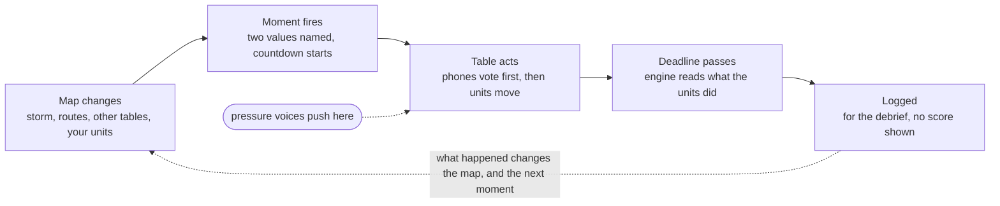
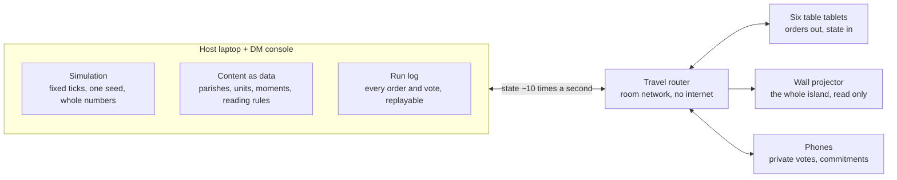

# Values Crucible: RTS design

Written 2026-10-21 for Jerry. Live, editable version: [Values Crucible: RTS design](https://claude.ai/artifact/YauQmeimoGG85FPkynmYBT). This file is a snapshot of it.

## Summary

The Values Crucible becomes a real-time strategy game. Six tables each command one parish of Concordia through Hurricane Midas. Every crew, boat, tanker, ambulance and helicopter is a unit you tap and send across a live island map. The dilemmas are no longer cards that arrive on a schedule. They grow out of what is happening on the map: a reservoir climbing toward 94%, a fishing boat adrift as the eye opens, a terminal crowd while the last plane boards.

When a dilemma fires, it names the two values in tension (for example **COURAGE vs SAFETY**) and starts a countdown. You answer by what your units do before the clock runs out. The engine stays a witness, not a judge. It records what each table did against the three values it stated at the start, and the debrief replays the island so the room can see the gap.

What changes from the card board:

- **You act on the map.** Units move along roads the storm is breaking. No A/B/C menus during play.
- **Values are named in the moment.** Each dilemma says which two values it tests, and which of your stated values is in play.
- **Dilemmas run in real time.** They are triggered by the state of the map and resolve on a deadline, not on a quarter card.
- **Everything is in Godot.** One project builds the tablet app, the wall, the facilitator console and phone pages ([[decision-2026-10-21-all-godot|decision record]]).

The decisions this design needs from Jerry are listed in the last section, Risks and open questions.

## Why the card board failed, and the goals that follow

Jerry played the solo board on 2026-10-21 and called it "not an actual RTS", with values decisions that "are not clear" and dilemmas that "aren't real time". The four-advisor audit had already found that the engine read 57 of 96 card options as Capitulating, and that the debrief ran 22 to 25 minutes against 15.

The root cause is that the map was a display. Every decision lived in a menu, the values at stake were hidden until the debrief, and the clock only decided when the next card appeared.

| Goal | What it means in the game | How we will know |
| --- | --- | --- |
| A real RTS | You select units and order them across the map; the storm and other tables act at the same time | A first-time player issues an order within 60 seconds of the brief ending, without help |
| Values clear at the moment | Each dilemma names its two values and flags which of your three stated values it tests | After a dilemma, a player can say which values were in tension |
| Dilemmas in real time | Dilemmas fire from map state with a visible deadline; doing nothing is also a choice | No dilemma arrives without something on the map that caused it |
| Readable by executives | No combat, no micromanagement, at most about 8 units per table, plain words, large type | A non-gamer can explain the screen to a colleague after one quarter |
| Witness, not judge | The game records actions against stated values; it never scores a table during play | The debrief shows evidence; the room draws the conclusion |
| Pressure that is real | Off-board voices (Chicago, the Governor, Marcus Webb) push in real time; permission and pressure are logged | The debrief can name who pressed, and whether the table complied |
| Survives the venue | Runs on the room's own network; no internet needed | A full rehearsal runs on a travel router with the venue Wi-Fi off |

## The 90-minute session

The session keeps the shape Jerry decided: 15 minutes of brief, 60 of play in four 15-minute quarters, and 15 of debrief. During play the island clock runs continuously from T-72h to T+48h, but not at one speed. Each quarter gets 15 real minutes for a different stretch of storm, so landfall runs slowest (12 storm hours, about 0.8 an hour per minute) and recovery fastest (42 storm hours, about 2.8 per minute).

| Segment | Real minutes | Storm time | What each table does |
| --- | --- | --- | --- |
| Brief | 0 to 15 | Frozen at T-72h | Meets its parish and residents, reads its sealed brief, picks and locks three values with a one-line statement, then plays a 3-minute practice: send a truck, load a boat, answer a test call |
| Q1 Preparation | 15 to 30 | T-72h to T-36h | Moves generators, fuel and crews while every road is open; trades with other tables face to face and on the map; the first dilemmas fire (the Priority Schedule, the order, the model) |
| Q2 Approach | 30 to 45 | T-36h to T-6h | Routes close one by one; the last plane, the four tankers and batch 47 compete for time; calls for aid start crossing the island |
| Q3 Landfall | 45 to 60 | T-6h to T+6h | No roads; units shelter or risk it; the eye opens a two-hour window (about two and a half real minutes) for boats and helicopters; the hardest dilemmas fire |
| Q4 Recovery | 60 to 75 | T+6h to T+48h | Roads reopen; who gets power and crews first; credit, blame and the statement |
| Debrief | 75 to 90 | Replay | The wall replays the storm; each table sees its stated values beside what it did; private commitments on phones |

The facilitator can pause the clock at any moment for a teaching beat. A pause stops the storm clock, so the quarter runs long by the length of the pause; the facilitator console shows the running overrun against the 90 minutes.

## The island as an RTS map

The board is the canon island art of Concordia, north up, 14 km across, drawn as a top-down map you can pan and pinch. Five parishes sit on the coast around a ring road and Heartland sits in the crater. Units travel on roads, sea lanes and air routes, and the storm closes them on the schedule in [[concordia-storm-quarters|Hurricane Midas in four quarters]]. The routes are where tables collide: two convoys on one road, a tanker that has not climbed before the Gorge Road floods.

| Route | Links | Closes | Reopens |
| --- | --- | --- | --- |
| Haven to Keystone ring road | The port and the plant | T-24h, flooded at the surge creek | T+24h |
| South Switchbacks | Keystone to Heartland, Caldera's only road out | T-18h, landslide | T+36h |
| Gateway to Summit road | Gateway's people to the city's shelters | T-18h, debris then water | T+24h |
| Gorge Road | Summit to Heartland beside the river | T-12h, floods with the first release | T+12h |
| Sterling to Haven road | The campus and the port | T-6h, under surge | T+24h |
| Summit to Sterling bridges | The capital and the campus | If the spillway opens (new in this design) | T+12h, when the release ends |
| Runway at Gateway | The only fixed-wing link | T-24h, 45 mph | T+12h, one lane, medevac |
| Sterling helicopters | Air anywhere, 6 seats | Above 40 mph; open again in the eye | T+6h |
| Harbour departures | Ships out of Haven | T-30h | T+36h for the next consignment |

What the map shows:

- **Hazard zones grow and shrink.** Surge fills Haven's yard, Southfield and the Mole; the river and the spillway fill Riverside and the lower campus. Anything inside a hazard zone is at risk and the people counter shows it.
- **Wind bands sweep across.** Above 40 mph nothing flies; above 85 mph the cranes stand down; in the eye everything at sea or in the air can move for about two and a half real minutes.
- **Fog is radio, not darkness.** A table sees its own sites and units exactly. Other parishes' units are visible as icons, but their sites show only the last radio report. When the cell network fails at T-12h, reports from other parishes slow down.

## Units and orders

Each table commands 5 to 9 units and 3 or 4 sites. Units are the resource tokens of [[crucible-resource-tokens-v3|the v3 token draft]] turned into things that move: a GEN token is a generator on a truck, a FUEL token is a tanker. Sites are fixed places with big levers. The counts stay unequal on purpose: Sterling holds the most and needs the least.

| Parish | Units | Sites and their levers |
| --- | --- | --- |
| Gateway | 3 rescue boats, 1 plane, 1 medic team, 1 generator, 1 tanker | Runway (board and fly the last plane), the Mole (shelter the fleet), Strand hotels (open as shelter) |
| Heartland | 3 generators ("dam spares"), 3 heavy crews, 1 tanker, 1 water tanker | Dam gate (open at a percentage), the works (run or stop), the Priority Schedule (who gets power) |
| Keystone | 3 generators, 1 reefer convoy, 1 medic team (EMTs), 1 tanker | Clean rooms (run, hold, shut), cold vault (doses or blood bank), plant basement (shelter) |
| Haven | 2 generators, 4 tankers (2 more hidden), 2 tugs, 1 longshore crew | Berth and the *Kestrel Reach* (load, sail, hold), fuel terminal and Tank 3, union hall (shelter) |
| Summit | 2 ambulance teams, 1 fire crew, 1 police boat, 1 tanker | Hospital, school shelters, the broadcast and the evacuation order |
| Sterling | 2 helicopters, 4 generators, 1 medic team, 1 tanker | The bunker door, the uplink, the fund and the pause (orders, not places) |

Orders a table can give:

1. **Move.** Tap a unit, tap a place. The route shows its arrival time and turns red if the storm will close it first.
2. **Deliver.** Send a generator, tanker or crew to a site, yours or another parish's. Arriving there hands it over.
3. **Rescue.** Send a boat, truck or helicopter to people in a hazard zone; it picks up as many as it holds and brings them to the nearest open shelter.
4. **Clear.** Send a crew to a blocked road; it reopens after a set time if the wind allows.
5. **Hold.** Park a unit somewhere safe. A unit left in a hazard zone can be damaged or lost, with its crew counted at risk.
6. **Pull a lever.** Tap a site and choose its action, such as "open the gate at 94%" or "sail with what is aboard". Levers are where most dilemmas land.

A table can queue one order behind the current one. Units move on their own once ordered, so a table spends its time deciding, not steering. Each table works on one shared tablet, with one person driving by default and the facilitator encouraging a rotation each quarter.

## Needs, people and resources

The island keeps the two counters from canon v3, always on screen: **doses shipped** (starts at 0; the world needs 170,000 this week) and **people safe** (starts at 24,100). Every order a table gives moves one counter or the other, and often both in opposite directions. That is the engine of every dilemma.

**People are on the map.** Each population at risk is a marker with a headcount and a face from [[crucible-residents-v3|the resident cards]]: Riverside's 2,000 under the gorge, Southfield's Block C, the 300 in Gateway's terminal, Caldera's 140 households, the two-man watch on the *Pacific Harvester*. When a hazard zone reaches a marker, its people leave the safe count. They come back when a unit brings them to a shelter with room. They do not come back if they are lost.

**Doses are a chain you can see.** Kelp trucks run from Gateway to Heartland's works, concentrate runs to Keystone, the reefer convoy runs doses to Haven's berth. This runs by itself while roads, power and crews hold. Each break shows on the map as a stalled link. Doses count as shipped only when the *Kestrel Reach* sails with them aboard. Nothing ships by itself, which closes the round-2 audit gap where doses shipped automatically and hoarding could win.

**Shelter is a capacity, not a token.** Every shelter shows places left (Summit's schools 2,400, Gateway's Strand 2,000 when opened, Haven's union hall 800, Sterling's bunker 500, Keystone's basement 400, Heartland's dam 300). A full shelter turns a rescue away. An unopened one is a choice.

**Keep or share is a physical act.** Sending a generator to Summit's hospital means a truck leaves your parish and drives there, and every table can see it go. Keeping it means it sits in your yard, also visible. Haven's two hidden tankers and Sterling's garage generators stay off the map until the table reveals them, and revealing them is logged.

## Real-time dilemmas

A dilemma is now a **moment**: something on the map reaches a point where a parish must choose, and two of its values pull opposite ways. The 24 dilemmas in [[crucible-dilemmas-v3|the v3 dilemma draft]] become 24 moments, four per parish, keeping their stories, personas and consequences. What changes is how they arrive and how they are answered.

A moment opens from the map and closes back into it. What the units did becomes the state that fires the next moment, for this table or another.

**How a moment fires.** Each moment has a trigger written as a map condition, not a time. The reservoir reaching 94% fires Heartland's gate moment, whenever that happens. If Heartland sent its generators away and the dam's controls are on one unit, it fires earlier. A moment that cannot happen does not fire: if Gateway brought the *Pacific Harvester* in before T-36h, there is no boat adrift in the eye.

**What the table sees.** A banner across the top of the tablet, and the map zooms to the place:

- the two values in tension, in large type: **COURAGE vs SAFETY**;
- a star on either value if it is one of the three the table stated in the brief;
- the persona's line, read aloud by the facilitator if they choose (Rosa Mendez: "I'm asking you, not telling you. That's new for me.");
- any pressure voice that is pushing, marked as pressure (Chicago: "Hold the ship for batch 47.");
- a countdown in real seconds, and what happens if the table does nothing.

**How a table answers.** By acting on the map. The moment lists the moves that matter as suggestions, such as "Send boats to the *Harvester*", "Send boats to Southfield", "Ask Sterling for a helicopter" or "Hold the boats". Tapping a suggestion selects the units, and the table still sends them. A table can also do something no suggestion named, and the engine reads that too. When the deadline passes, whatever the units are doing is the answer. Doing nothing is recorded as "the storm decided" and carries no value reading, as in the cut A rules.

**Phones.** Before the table acts, each player can vote privately on their phone for the move they would make. The count shows on the tablet, but who voted for what stays hidden until the debrief, where it shows whether the table overrode its own quiet majority.

| Moment | Fires when | Values | Answered by |
| --- | --- | --- | --- |
| The *Harvester* in the eye (Gateway) | The *Harvester* is adrift and the eye opens | Courage vs safety | Where the three boats go before the backside: the *Harvester*, Southfield, both, or nowhere |
| 94, 97, 99 (Heartland) | Reservoir reaches 94% | Courage vs duty | When the gate lever is pulled, and whether the warning goes out first |
| The last plane (Gateway) | 45 seats left and more than 45 people in the terminal | Fairness vs loyalty | Who is loaded onto the plane unit before it flies |
| Southfield (Keystone) | Block C floods while the skeleton crew holds the clean rooms | Respect vs duty | Whether the reefer convoy goes to Block C, and whether the clean-room lever is set to run, ask or shut |
| Four tankers (Haven) | Tankers are idle at the terminal and more than two parishes have asked for fuel | Honesty vs stewardship | Where each tanker drives before the roads close |
| A call for aid (any) | Another table asks for a unit you hold | Set by the request, such as loyalty vs compassion | Whether you send it, and whether it arrives before the route closes |

Moments chain. The water from Heartland's gate is the water in Riverside when Summit's "thirty officers" moment fires. What a table did an hour ago changes what the next table faces.

## Reading values from actions

The engine is a witness. It reads what a table did, never what it said it would do, and it places each moment on the dissertation's seven anchors. It never places a person or a table. The rules from the audit fixes (cut A and cut B) carry over unchanged.

| Anchor | Reading | In the game |
| --- | --- | --- |
| +3 | Heroic | A costly act for others, against pressure, with your own people at risk |
| +2 | Exemplifying | Serving a value at a real cost to your parish |
| +1 | Striving | Serving a value when it costs you little |
| 0 | Minimum Organizational Expectations | Doing what the role requires, and no more |
| -1 | Faltering | Letting a value slip with no one pushing |
| -2 | Capitulating | Giving way to a named pressure (only ever read where a pressure voice was active) |
| -3 | Villainous | Harming others for your own gain, knowingly |

**How a moment is read.** Each moment's content lists outcome rules, for example "two or more boats reached the *Harvester* before T+1:30". When the deadline passes, the engine matches the units' actual state to a rule and records one reading per value tested. Moves outside the moment are read by standing rules, such as sending a generator another parish needs before you do, keeping a tanker nobody else needs, or revealing hidden stock.

**Rules kept from the audit fixes:**

- One reading per value per moment, the strongest signal, with ties going negative.
- Silence when the deadline passes is "the storm decided" and carries no reading.
- Complying with a coercer reads 0 at most on the value the coercer invokes.
- A send that costs the sender nothing it needs reads Striving (+1) at most.
- A move the engine refused says why on screen and is not read.

**During play, no scores.** When a moment closes, the tablet shows one plain line of fact, such as "Logged: three boats went to Southfield; the *Harvester* waits for the sky." Readings appear only in the debrief, after the table has placed its own hardest moment on the scale first (decision D7). Whether to also show which value the move served, at the moment, is an open question for Jerry.

**What is logged.** Every order with its storm minute, the state of the map when each moment fired, which pressure voices were active, any permission the facilitator gave, every phone vote, and the seed. That is enough to replay the whole session exactly.

## Six tables, one island

The six tables play on one shared island at the same time. No table can win alone, because each holds a link the others need: Gateway's kelp, Heartland's power and water, Keystone's doses, Haven's fuel and berth, Summit's hospital and order, Sterling's helicopters and money.

- **Calls for aid are pings on the map.** A table taps a place and asks for a kind of unit, such as "a generator to Hospital Hill" with one line of reason. The ping appears on every table's map and flashes on the tablets of tables that hold that kind of unit. Answering means sending a unit. Arrival depends on the route still being open, as in [[crucible-calls-for-aid-v3|the calls-for-aid draft]].
- **Everyone sees the units move.** A tanker leaving Haven for Summit, or Sterling's four generators parked in the campus yard while Summit's hospital pings, is visible on every tablet and on the wall. Keeping is as public as giving.
- **Talk is free, and only moves count.** Tables can walk over and negotiate. Promises are not entered into anything; only units that actually move are recorded.
- **Roads are shared.** The Switchbacks and the river bridges carry one convoy at a time, so two tables that both need the Gorge Road at T-14h have to sort out who goes first.
- **Pressure comes from off the board.** Chicago, the Governor's office and Marcus Webb press tables by message. Tables never apply scored pressure to each other, per the audit rule.
- **Empty seats are filled by bots.** If fewer than six tables are playing, bots run the missing parishes through the same orders a person would give. A table that joins later takes over from its bot.

## The facilitator

The facilitator (the DM) runs the room from a laptop that also hosts the game. The DM shapes the experience but never overrides an outcome: the engine decides what the storm and the units do.

| Lever | What it does | Logged |
| --- | --- | --- |
| Pause and resume | Freezes the storm clock for a teaching beat; tablets show "Paused by the facilitator" | Yes |
| Heat and cool | Moves the storm's intensity curve up or down a step, which shortens or lengthens moment deadlines by about 20 seconds | Yes |
| Voice a persona | Plays or reads a persona's line into a moment (Rosa Mendez, Yuki Tanaka, Frank Reeves) | Yes |
| Send pressure | Fires an off-board message at one table, such as Chicago demanding the ship sail | Yes, as pressure |
| Give permission | Tells a table, in the voice of authority, that it may break a rule ("You have the Governor's cover") | Yes, as permission |
| Flag a moment | Marks a moment for the debrief | Yes |
| Fill a seat | Hands an empty or stuck parish to a bot, or back to people | Yes |

The DM screen shows all six parishes at once: each table's current moment and countdown, its units, its open calls for aid, and a running overrun against the 90 minutes. A one-page run card covers the session for a facilitator who has never seen the game, and a rehearsal mode runs all six parishes with bots at high speed so the DM can practise in 5 minutes.

## The debrief

The debrief is 15 minutes, stepped by the facilitator, and built on a replay of the island. The room watches its own storm again at high speed on the wall, and the DM stops it at the flagged moments.

1. **The storm again (3 minutes).** The wall replays T-72h to T+48h in about 90 seconds, with both counters and every unit moving. The DM stops on two or three flagged moments.
2. **Place your hardest moment (3 minutes).** Each table picks its own hardest moment and places it on the seven anchors before seeing the engine's reading.
3. **Stated beside enacted (4 minutes).** Each tablet shows the table's three stated values beside what its moves read, moment by moment, with the map replay of each. The wall shows only the room's pattern by kind of pressure, never by table.
4. **Permission and pressure (3 minutes).** For each moment where a pressure voice was active, or permission was given, the table sees what it did and the question: "What would it have taken to say it out loud?"
5. **Commit (2 minutes).** Each person writes a private if-then commitment on their phone. It never leaves the phone.

Nothing in the debrief ranks tables. Per decision D2, a table's own record stays on its own tablet, and the wall shows patterns across the room.

## Screens

Four screens, one game. Every screen is built for a reader who has never played a strategy game: large type, plain words, one thing asking for attention at a time.

| Screen | Device | Who | What it shows |
| --- | --- | --- | --- |
| Table | A tablet per table, landscape, about 11 inches | The parish council, one driver at a time | The island centred on the parish; its units and sites; the moment banner with the two values and the countdown; its three stated values pinned at the top; incoming calls for aid; both counters |
| Wall | Projector, 1080p | The whole room | The whole island, every unit moving, the storm, routes closing, both counters, the room's pattern in the debrief; never a table's private record |
| Facilitator | Laptop, also the host | The DM | All six parishes at a glance, moments and countdowns, levers, the persona lines to read, the run card, the overrun clock |
| Phone | Each participant's own phone, in the browser | One person | The private vote on each moment, the sealed brief only where the role allows, and the private commitment at the end |

Readability rules for executives:

- Text is at least 22 px on the wall and 16 px on the tablet; values in a moment banner are the largest words on the screen.
- Colour always means the same thing: a parish's colour for its units, red only for danger, the accent only for the current moment.
- No numbers the table cannot act on. A unit shows where it is going and when it will arrive; a site shows what it holds and what it needs.
- Every tap gives a visible result within half a second, and a refused order says why in words.

## Technical design in Godot

One Godot 4.7 project, written in GDScript, builds every screen. The facilitator's laptop is the single source of truth. It runs the simulation and every other device draws what it sends.

Only the host decides anything. Tablets and phones send orders and votes in, and get the island's state back, so a dropped tablet loses nothing.

**Determinism.**

- The host steps the island at a fixed 10 ticks per second of storm play. Positions are whole metres, time is whole storm minutes, and all rules use whole numbers.
- One seeded random generator lives on the host, and only the host draws from it.
- No physics engine decides an outcome. Units follow road graphs, not collisions.
- Every order is stamped with the tick it applies on, and the host hashes the state every tick. The same seed and the same orders give the same game, and a replay must reproduce the final hash.

**Networking without venue Wi-Fi.**

- The facilitator brings a travel router. Every device joins its network; no internet is used.
- Godot's built-in multiplayer runs over WebSockets, so native apps and browsers can join the same game.
- Tablets send orders and receive the state about 10 times a second, and draw smooth motion between updates. A tablet that drops reconnects and resumes from the current state.

**Devices.** The simplest path for the conference is the web build: the host serves it on the room's network and every tablet opens one address in its browser, with nothing to install. Godot's single-threaded web export (the default since 4.3) needs no special server settings. Native iPad and Android apps come later from the same project, since an iPad app needs Apple signing from a Mac.

**Testing.** Godot runs headless in the cloud workspace, which was verified on 2026-10-21. Each change runs:

- unit tests on the rules;
- a determinism test, running the same seed and orders twice and comparing hashes;
- a golden replay;
- a full bot session of all six parishes at high speed;
- screenshots of each screen at key moments.

Frame rate on a real classroom tablet is measured by hand at each milestone, because nothing in the cloud can stand in for one.

## What carries over

Most of the work so far is story, research and rules, and almost all of it carries over. What does not carry over is the card loop and the code that runs it.

| Carries over | From | How it is used |
| --- | --- | --- |
| The world: parishes, routes, populations, personas | `concordia-parishes-v3.md`, `concordia-storm-quarters.md` | The map, the route schedule, the persona lines |
| 24 dilemmas with options, signals and consequences | `crucible-dilemmas-v3.md` | Rewritten as 24 moments with triggers and outcome rules |
| Residents, secret briefs, tokens, calls for aid | The other `crucible-*-v3.md` drafts | People markers, sealed briefs, units, aid pings |
| Values deck (40 values), seven anchors, permission and pressure | `crucible/content/values.json`, the dissertation | The brief's value pick, the debrief scale, pressure logging |
| Audit rules (cut A and cut B) | The two build logs | Reading rules, unchanged |
| Session shape, debrief steps, DM levers | `values-crucible-session-90.md`, the cut A debrief | Session clock, debrief, DM console |
| Island art | `crucible/board/concordia-1400.jpg` | The map's base layer, redrawn at higher resolution for the wall |
| Rust engine and board code | `crucible/` | Reference only, until Godot matches it; then retired |

The content files in `crucible/content/*.json` were never converted to v3. They are converted once, straight into the Godot project's data folder, rather than twice.

## Build plan

The build runs in six phases, and each ends in a gate that can be checked rather than argued. Phase 2 is the first time Jerry plays anything, and it is the go or no-go for the whole direction.

| Phase | What gets built | Gate |
| --- | --- | --- |
| 1. Foundations | Godot project, island map, road graph, units that move, fixed-tick host, run log | The same seed and orders, run twice, give the same state hash |
| 2. One parish you can play | One parish with the storm, closing routes, 4 moments, and bots running the other five | Jerry plays 10 minutes and says it feels like an RTS |
| 3. The whole island | All six parishes, all units, 24 moments, calls for aid, value readings | A full bot session runs clean and every reading rule has a test |
| 4. The room | Tablets, wall, facilitator console and phones on the room's own network | Six devices play a full session on a travel router with the venue Wi-Fi off |
| 5. The debrief | Replay, place your hardest moment, stated beside enacted, permission and pressure, commitments | The debrief fits in 15 minutes in a timed rehearsal |
| 6. Playtest and polish | A group of non-gamers plays the full 90 minutes; fix what they trip on | The group plays start to finish without help from the builder |

How long each phase takes depends on the conference date, which is still open. The order does not: nothing networked is built before one parish plays well on one screen.

## Risks and open questions

The biggest risk is that a real-time game buries the reflection it exists for: tables busy steering units have no time to argue about values. The design answers that with few units, orders that run themselves, and countdowns long enough to talk. Phase 2 tests it before anything else is built.

| Risk | Why it matters | Fallback |
| --- | --- | --- |
| Too busy to reflect | The point is the values conversation, not the clicking | Fewer units, longer moment countdowns, a facilitator pause at each landfall moment |
| Executives who do not play games freeze | A table that cannot act learns nothing | The 3-minute practice in the brief, suggested moves on every moment, a facilitator who can drive for a table |
| Tablets too slow for the map | A stuttering map reads as broken | The compatibility renderer, fewer effects, frame rate measured on the real tablet at every phase |
| Venue network trouble | The session dies with the Wi-Fi | Own travel router; tablets reconnect and resume; the host keeps the clock |
| Readings feel like grades | The witness model fails if tables feel judged | No scores during play; one reading per moment; the table places its own moment first |
| Rebuild takes longer than the conference allows | No game on the day | The conference date sets the scope; the card board still runs as a fallback |

Decisions for Jerry. Each will come as a card with a recommendation:

- [ ] **Conference date and room.** How many tables, how many people per table, and what tablets?
- [ ] **Which parish for the phase 2 slice?** The recommendation is Keystone: it has the doses, Southfield and the clearest tension between production and people.
- [ ] **Value feedback during play.** Show only the fact of what happened (recommended), or also which value the move served?
- [ ] **What tables can see of each other.** Every unit visible (recommended), or only your own plus radio reports?
- [ ] **Phones.** Keep the private vote and commitment (recommended), or drop phones and keep everything on the tablet?
- [ ] **Phone page.** A small plain web page served by the host is lighter on phones than a Godot web build. Is that an acceptable exception to "all Godot"?
- [ ] **Moment content.** The 24 v3 dilemmas need triggers and outcome rules written for them. Jerry reviews each set by parish, since content is his call.
- [ ] **The reflexive issue engine.** It fits as extra moments written live by Claude, approved by the facilitator and logged as inputs so replay still works. Build it in phase 3, or after the conference?
