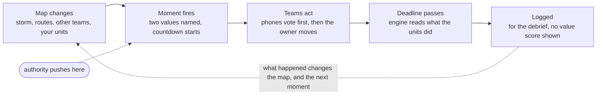
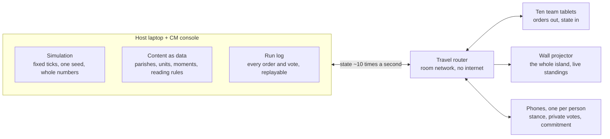

# Values Crucible: RTS design

Written 2026-10-21 for Jerry, revised the same evening after the flow and teams grilling. Live, editable version: [Values Crucible: RTS design](https://claude.ai/artifact/YauQmeimoGG85FPkynmYBT). This file is a snapshot of it.

## Summary

The Values Crucible becomes a real-time strategy game. Ten teams command the five parishes of Concordia through Hurricane Midas. In each parish, a **community team** speaks for the local people and a **Meridian team** speaks for the company's interests. Every crew, boat, tanker, ambulance and helicopter is a unit you tap and send across a live island map. The dilemmas are no longer cards that arrive on a schedule. They grow out of what is happening on the map: a reservoir climbing toward 94%, a fishing boat adrift as the eye opens, a terminal crowd while the last plane boards.

When a dilemma fires, it names the two values in tension (for example **COURAGE vs SAFETY**) and starts a countdown. Both teams in the parish vote on their phones, and the team that owns the resources at stake decides. The team holding the most resources at the end wins, so every unit spent saving people costs standing. That is the temptation. On values, the engine stays a witness, not a judge. It records what each team did against the stance it built at the start, and the debrief sets the winner's crown beside the people lost.

What changes from the card board:

- **You act on the map.** Units move along roads the storm is breaking. No A/B/C menus during play.
- **Values are named in the moment.** Each dilemma says which two values it tests, and where they sit in your team's ranking.
- **Dilemmas run in real time.** They are triggered by the state of the map and resolve on a deadline.
- **Two teams share each parish.** The community has breadth: many smaller resources. Meridian has depth: fewer, far bigger ones. Whoever owns the resource decides, and the other team's vote shows as advice.
- **Reflection is built in.** A values stance up front, a Mission brief after each quarter, and a final debrief, in a 120-minute session the Crucible master (CM) can re-time.
- **Everything is in Godot** ([[decision-2026-10-21-all-godot|decision record]]).

Jerry set the flow, the teams and the five parishes in a grilling on 2026-10-21, recorded in [[decision-2026-10-21-rts-flow-and-teams|the flow and teams decision]]. The decisions still open are in the last section, Risks and open questions.

## Why the card board failed, and the goals that follow

Jerry played the solo board on 2026-10-21 and called it "not an actual RTS", with values decisions that "are not clear" and dilemmas that "aren't real time". The four-advisor audit had already found that the engine read 57 of 96 card options as Capitulating, and that the debrief ran 22 to 25 minutes against 15.

The root cause is that the map was a display. Every decision lived in a menu, the values at stake were hidden until the debrief, and the clock only decided when the next card appeared.

| Goal | What it means in the game | How we will know |
| --- | --- | --- |
| A real RTS | You select units and order them across the map; the storm and the other teams act at the same time | A first-time player issues an order within 60 seconds of the practice starting, without help |
| Values clear at the moment | Each dilemma names its two values and shows where they sit in your team's ranking | After a dilemma, a player can say which values were in tension |
| Dilemmas in real time | Dilemmas fire from map state with a visible deadline; doing nothing is also a choice | No dilemma arrives without something on the map that caused it |
| A real cost to doing right | The team with the most resources at the end wins, so helping costs standing | Teams argue about whether to spend, not only how |
| Learning, not just playing | Four rounds of doing, reflecting and trying again: the stance, three Mission briefs, the debrief | Each team can name an intent it set and whether it held |
| Readable by executives | No combat, no micromanagement, about 8 units per team at most, plain words, large type | A non-gamer can explain the screen to a colleague after one quarter |
| Witness, not judge | The game scores resources in the open but never scores values during play | The debrief shows evidence; the room draws the conclusion |
| Pressure that is real | Authority pushes in real time: Meridian HQ on its Meridian teams, Sterling's government on communities, and scripted voices from off the map | The debrief can name who pressed, with what authority, and whether the team complied |
| Survives the venue | Runs on the room's own network; no internet needed | A full rehearsal runs on a travel router with the venue Wi-Fi off |

## The 120-minute session

The session runs 120 minutes by default:

- a 30-minute front end;
- 56 minutes of play in four 14-minute quarters;
- a 4-minute Mission brief after each of the first three quarters;
- a 22-minute final debrief.

The Crucible master sets every length in setup and can stretch or cut a Mission brief live. Each change is logged, so the replay still matches.

During play the island clock runs from T-72h to T+48h, at a different speed in each quarter. Landfall runs slowest: 12 storm hours in 14 minutes. Recovery runs fastest: 42 storm hours, about 3 an hour per minute.

| Segment | Real minutes | Storm time | What each team does |
| --- | --- | --- | --- |
| Front end | 0 to 30 | Frozen at T-72h | Builds its values stance (below); meets its parish, residents and sealed brief; picks its first rep; plays a 3-minute practice |
| Q1 Preparation | 30 to 44 | T-72h to T-36h | Moves generators, fuel and crews while every road is open; first trades; the first moments fire |
| Mission brief 1 | 44 to 48 | Paused | Looks back, gets the next situation report, sets an intent |
| Q2 Approach | 48 to 62 | T-36h to T-6h | Routes close one by one; the last plane, the four tankers and batch 47 compete for time; calls for aid cross the island |
| Mission brief 2 | 62 to 66 | Paused | As above |
| Q3 Landfall | 66 to 80 | T-6h to T+6h | No roads; units shelter or risk it; the eye opens a two-hour window (about two and a half real minutes); the hardest moments fire |
| Mission brief 3 | 80 to 84 | Paused | As above |
| Q4 Recovery | 84 to 98 | T+6h to T+48h | Roads reopen; who gets power and crews first; credit, blame and the statement |
| Debrief | 98 to 120 | Replay | The crown and its cost, me and us and what we did, intents, permission and pressure, commitments |

The CM can also pause the clock at any moment for a teaching beat. A pause stops the storm clock, so the session runs long by the length of the pause, and the CM console shows the running overrun.

### The front end: a values stance

The stance is built in three steps, about 20 minutes in all.

1. **Me.** Each person picks three values from the deck on their phone and tells their team a 60-second story about a time one of them cost them something.
2. **Us.** The team agrees on three values.
3. **The trade-off.** The team ranks its three values for when they collide, and signs a one-line statement.

The CM tells the room why the game exists, but not how values are read: the island remembers what you do, not what you say; nothing about values is scored during play; we look at it together at the end. The seven anchors appear only in the debrief.

No step links the island to the players' own jobs. The scenario has to resonate on its own, through residents with names and faces and stakes that feel like leadership.

### Mission briefs

After Q1, Q2 and Q3, the storm pauses for 4 minutes.

- **Look back (1.5 minutes).** The tablet replays the team's quarter as facts only, and the standings show on the wall. One question asks about the ranked values, such as "Which of your three got quieter this quarter?"
- **Brief forward (2.5 minutes).** A situation report for the next quarter says what the storm will do and which routes close. The team then writes one if-then intent, such as "When HQ pushes, we will name the cost out loud first." The intent is pinned to the tablet.

The next quarter marks when an intent is tested, and the debrief shows whether it held. The CM can edit the questions.

## The island as an RTS map

The board is the canon island of Concordia, north up, about 14 km across, drawn as a top-down map you can pan and pinch. It has five parishes, four on the coast and one in the centre:

- **The centre** (name to be chosen). Heartland and Summit merged: Meridian HQ, the kelp works, and the dam with its reservoir, a Meridian asset built on the community's behalf.
- **Sterling**, the whole north tile. The capital, the hospital and the government.
- **Gateway.** The kelp harvest, the airport and the tourists.
- **Keystone.** The plant that makes the cure.
- **Haven.** The port.

Units travel on roads, sea lanes and air routes, and the storm closes them on the schedule in [[concordia-storm-quarters|Hurricane Midas in four quarters]]. The routes are where teams collide: two convoys on one road, or a tanker that has not climbed before the Gorge Road floods. The table is a first cut for the five-parish map, and gets fitted to the redrawn art in the v4 pass.

| Route | Links | Closes | Reopens |
| --- | --- | --- | --- |
| Haven to Keystone coast road | The port and the plant | T-24h, flooded at the surge creek | T+24h |
| South Switchbacks | Keystone to the centre; Caldera's only road out | T-18h, landslide | T+36h |
| Gateway to Sterling coast road | Gateway's people to the capital's shelters | T-18h, debris then water | T+24h |
| Gorge Road | Sterling to the centre, beside the river | T-12h, floods with the first release | T+12h |
| Sterling to Haven road | The capital and the port | T-6h, under surge | T+24h |
| River bridges | The centre and Sterling | If the spillway opens | T+12h, when the release ends |
| Runway at Gateway | The only fixed-wing link | T-24h, 45 mph | T+12h, one lane, medevac |
| Meridian helicopters | Air anywhere, 6 seats, based at HQ | Above 40 mph; open again in the eye | T+6h |
| Harbour departures | Ships out of Haven | T-30h | T+36h for the next consignment |

What the map shows:

- **Hazard zones grow and shrink.** Surge fills Haven's yard, Southfield and the Mole; the river and the spillway fill Riverside and the lower campus. Anything inside a hazard zone is at risk and the people counter shows it.
- **Wind bands sweep across.** Above 40 mph nothing flies; above 85 mph the cranes stand down; in the eye everything at sea or in the air can move for about two and a half real minutes.
- **Fog is radio, not darkness.** A team sees its own parish's sites and units exactly. Other parishes' units are visible as icons, but their sites show only the last radio report. When the cell network fails at T-12h, reports from other parishes slow down.

## Units and orders

Each parish has two pools of units, and each team commands its own.

- **Community units have breadth:** many smaller things, such as boats, crews, ambulances, volunteers and shelters.
- **Meridian units have depth:** fewer, far bigger assets, such as helicopters, the generator fleet, the plant, the dam and money.

Units are the resource tokens of [[crucible-resource-tokens-v3|the v3 token draft]] turned into things that move: a GEN token is a generator on a truck, a FUEL token is a tanker. The table below is a first cut for Jerry to correct. The v4 content pass sets each team's starting units and what each is worth in the standings.

| Parish | Community units and sites | Meridian units and sites |
| --- | --- | --- |
| Gateway | 3 rescue boats, 1 medic team, the Mole (fleet shelter), the Strand hotels (shelter) | The last plane and the runway, the kelp fleet, 1 generator, 1 tanker |
| The centre | 3 heavy crews, 1 water tanker, the dam shelter | The dam gate, the kelp works, 3 dam generators, 2 helicopters, the fund, HQ's hidden reserve |
| Keystone | 1 medic team (EMTs), the plant basement (shelter), Caldera's households | The clean rooms, the cold vault, the reefer convoy, 3 generators, 1 tanker |
| Haven | 1 longshore crew, the union hall (shelter) | 4 tankers (2 hidden), 2 tugs, the berth and the *Kestrel Reach*, the fuel terminal and Tank 3 |
| Sterling | 2 ambulance teams, 1 fire crew, 1 police boat, the hospital, the school shelters, the broadcast and the evacuation order | 2 generators, 1 tanker, the Meridian office tower |

Orders a team can give its own units:

1. **Move.** Tap a unit, tap a place. The route shows its arrival time and turns red if the storm will close it first.
2. **Deliver.** Send a generator, tanker or crew to a site, yours or another parish's. Arriving there hands it over.
3. **Rescue.** Send a boat, truck or helicopter to people in a hazard zone; it picks up as many as it holds and brings them to the nearest open shelter.
4. **Clear.** Send a crew to a blocked road; it reopens after a set time if the wind allows.
5. **Hold.** Park a unit somewhere safe. A unit left in a hazard zone can be damaged or lost, with its crew counted at risk.
6. **Pull a lever.** Tap a site and choose its action, such as "open the gate at 94%" or "sail with what is aboard". Levers are where most dilemmas land.

A team can queue one order behind the current one. Units move on their own once ordered, so a team spends its time deciding, not steering. Each team works on its own tablet. Both tablets in a parish show the whole parish and every unit in it, but a team can order only the units it owns. Tapping the other team's unit offers to ask for it.

## Needs, people and resources

The island keeps the two counters from canon v3, always on screen: **doses shipped** (starts at 0; the world needs 170,000 this week) and **people safe** (starts at 24,100). Every order a team gives moves one counter or the other, and often both in opposite directions. That is the engine of every dilemma.

**People are on the map.** Each population at risk is a marker with a headcount and a face from [[crucible-residents-v3|the resident cards]]: Riverside's 2,000 under the gorge, Southfield's Block C, the 300 in Gateway's terminal, Caldera's 140 households, the two-man watch on the *Pacific Harvester*. When a hazard zone reaches a marker, its people leave the safe count. They come back when a unit brings them to a shelter with room. They do not come back if they are lost.

**Doses are a chain you can see.** Kelp trucks run from Gateway to the centre's works, concentrate runs to Keystone, the reefer convoy runs doses to Haven's berth. This runs by itself while roads, power and crews hold. Each break shows on the map as a stalled link. Doses count as shipped only when the *Kestrel Reach* sails with them aboard. Nothing ships by itself, which closes the round-2 audit gap where doses shipped automatically and hoarding could win.

**Shelter is a capacity, not a token.** Every shelter shows places left (Sterling's schools 2,400, Gateway's Strand 2,000 when opened, Haven's union hall 800, Keystone's basement 400, the centre's dam 300, and Meridian HQ's bunker 500, which opens only if the centre's Meridian team opens it). A full shelter turns a rescue away. An unopened one is a choice.

**Keep, give, lend or trade.** Sending a generator to another parish means a truck leaves and drives there, and every team can see it go. When it sends, the owner picks one of three:

- **Gift:** it leaves your standing for good and joins theirs.
- **Loan:** it comes back after the need passes, if the storm spares it.
- **Trade:** an offer on the map, such as "our generator for your tanker". When the other side accepts, both move together.

Spoken promises are not enforced; only moves count. Haven's two hidden tankers and HQ's reserve stay off the map until revealed, and revealing them is logged.

**Most resources wins.** Every resource has a value, and the team holding the most at the end of Q4 wins. The standings show live on the wall and again at each Mission brief. Resources used up saving people, such as fuel burned, doses given or a boat lost in the eye, are gone. That is the designed temptation: helping costs standing, and hoarding is always on offer. The debrief puts the people lost beside the winner's crown. How doses, money and people count toward standing is set in the v4 content pass.

## Real-time dilemmas

A dilemma is now a **moment**: something on the map reaches a point where a parish must choose, and two of its values pull opposite ways. The 24 dilemmas in [[crucible-dilemmas-v3|the v3 dilemma draft]] become 24 moments, four per parish, keeping their stories, personas and consequences. What changes is how they arrive and how they are answered.

A moment opens from the map and closes back into it. What the units did becomes the state that fires the next moment, for this team or another.

**How a moment fires.** Each moment has a trigger written as a map condition, not a time. The reservoir reaching 94% fires the centre's gate moment, whenever that happens. If the centre's Meridian team sent its generators away and the dam's controls are on one unit, it fires earlier. A moment that cannot happen does not fire: if Gateway brought the *Pacific Harvester* in before T-36h, there is no boat adrift in the eye.

**What both teams see.** A banner across the top of both tablets in the parish, and the map zooms to the place:

- the two values in tension, in large type: **COURAGE vs SAFETY**;
- where each value sits in each team's ranking, if it is one of its three;
- who decides: which team owns the resources at stake;
- the persona's line, read aloud by the CM if they choose (Rosa Mendez: "I'm asking you, not telling you. That's new for me.");
- any push that is under way, and from whom (HQ: "Hold the ship for batch 47.");
- a countdown in real seconds, and what happens if nobody acts.

**How a parish answers.** Every person on both teams votes on their phone for the move they would make. Each team's majority is its vote, and both votes show on both tablets.

- **Who decides.** The team that owns the resources at stake decides and sends the units. The other team's vote is advice.
- **Moments that need both.** If a moment needs both kinds of resource, each team decides its own part.
- **Ties.** A 3–3 split inside a team goes to that quarter's rep. The role passes to someone new each quarter.

Tapping a suggested move selects the units, and the team still sends them. A team can also do something no suggestion named, and the engine reads that too. When the deadline passes, whatever the units are doing is the answer. Doing nothing is recorded as "the storm decided" and carries no value reading.

**Phones stay private.** The tablets show vote counts, never names. In the debrief, each person's own phone shows their stance, their votes, and the moments where their team went the other way. Nobody else sees them.

| Moment | Fires when | Values | Who decides |
| --- | --- | --- | --- |
| The *Harvester* in the eye (Gateway) | The *Harvester* is adrift and the eye opens | Courage vs safety | The community, on where its boats go; Meridian, on whether its helicopter flies |
| 94, 97, 99 (the centre) | The reservoir reaches 94% | Courage vs duty | Meridian owns the dam gate; the community decides whether to clear Riverside first |
| The last plane (Gateway) | 45 seats are left and more than 45 people are in the terminal | Fairness vs loyalty | Meridian, which owns the plane |
| Southfield (Keystone) | Block C floods while the skeleton crew holds the clean rooms | Respect vs duty | Meridian, on the clean rooms and the reefer convoy; the community, on its medics and the basement shelter |
| Four tankers (Haven) | Tankers are idle at the terminal and more than two parishes have asked for fuel | Honesty vs stewardship | Meridian, which owns the tankers |
| A call for aid (any) | Another team asks for a unit you hold | Set by the request, such as loyalty vs compassion | The owner, as a gift, a loan or a trade |
| An order from authority (any) | HQ orders a Meridian team, or Sterling orders a community | Set by the order | The team ordered; this counts as pressure |

Moments chain. The water from the centre's dam gate is the water in Riverside when Sterling's "thirty officers" moment fires. What one team did an hour ago changes what the next team faces.

## Reading values from actions

The engine is a witness. It reads what a team did, never what it said it would do, and it places each moment on the dissertation's seven anchors. It never places a person or a team. The rules from the audit fixes (cut A and cut B) carry over unchanged.

| Anchor | Reading | In the game |
| --- | --- | --- |
| +3 | Heroic | A costly act for others, against pressure, with your own people at risk |
| +2 | Exemplifying | Serving a value at a real cost to your parish |
| +1 | Striving | Serving a value when it costs you little |
| 0 | Minimum Organizational Expectations | Doing what the role requires, and no more |
| -1 | Faltering | Letting a value slip with no one pushing |
| -2 | Capitulating | Giving way to a named pressure (only ever read where a pressure voice was active) |
| -3 | Villainous | Harming others for your own gain, knowingly |

**How a moment is read.** Each moment's content lists outcome rules, for example "two or more boats reached the *Harvester* before T+1:30". When the deadline passes, the engine matches the units' actual state to a rule and records one reading per value tested. Moves outside the moment are read by standing rules, such as sending a generator another parish needs before you do, keeping a tanker nobody else needs, or revealing hidden stock.

**Rules kept from the audit fixes:**

- One reading per value per moment: the strongest signal, with ties going negative.
- Silence when the deadline passes is "the storm decided" and carries no reading.
- **Pressure comes from authority.** Pressure means a push from Meridian HQ on a Meridian team, an order from Sterling's government to a community, or a scripted voice from off the map. A push between peer teams is logged as persuasion, not pressure. Capitulating (−2) is read only under pressure.
- Complying with a coercer reads 0 at most on the value the coercer invokes.
- A send that costs the sender nothing it needs reads Striving (+1) at most. A gift, a loan and a trade cost different amounts, and the kind of send is part of the reading.
- Each team is read only on the decisions it owned. The rep's tie-breaks are logged.
- A move the engine refused says why on screen and is not read.

**During play, no value scores.** The resource standings are public, because they are the game. Value readings are not. When a moment closes, the tablet shows one plain line of fact, such as "Logged: three boats went to Southfield; the *Harvester* waits for the sky." Readings appear only in the debrief, after each team has placed its own hardest moment on the scale first (decision D7). Whether to also show which value a move served, at the moment it happens, is an open question for Jerry.

**What is logged.**

- every order, with its storm minute;
- the state of the map when each moment fired;
- every person's vote, each team's vote, and which team decided;
- each rep's tie-breaks;
- every gift, loan and trade;
- every push, with its authority, and any permission the CM gave;
- each Mission brief intent;
- every timing change the CM made;
- the seed.

That is enough to replay the whole session exactly.

## Ten teams, one island

Ten teams play on one shared island at the same time: a community team and a Meridian team in each of the five parishes. At the nurses session (about 60 people) that is 6 per team. At Penn CLO in March 2027 (about 30 people) it is 3 per team. No team can win alone. Each parish holds links the others need, and each team in a parish needs the other team's resources.

- **Two teams, one parish.** Both teams see the whole parish and vote on every moment, and the owner of the resources at stake decides. The community's breadth meets Meridian's depth, and the back-and-forth between them is the point.
- **Authority sits on the map.** Meridian HQ is the centre's Meridian team, and it can order the other four Meridian teams. Sterling's government can order communities, for example with the evacuation order or a curfew. Both kinds of order count as pressure. Scripted voices from off the map, such as the board in Chicago or Marcus Webb, still push too.
- **Calls for aid are pings on the map.** A team taps a place and asks for a kind of unit, such as "a generator to the hospital", with one line of reason. The ping appears on every map and flashes on the tablets of teams that hold that kind of unit. Answering means sending a unit as a gift, a loan or a trade. Arrival depends on the route still being open, as in [[crucible-calls-for-aid-v3|the calls-for-aid draft]].
- **Everyone sees the units move.** A tanker leaving Haven, or HQ's helicopters parked while Sterling's hospital pings, shows on every tablet and on the wall. Keeping is as public as giving.
- **Talk is free, and only moves count.** Teams can walk over and negotiate. Trades made on the map are enforced; promises are not.
- **Roads are shared.** The Switchbacks and the river bridges carry one convoy at a time, so two teams that both need the Gorge Road at T-14h have to sort out who goes first.
- **Empty seats are filled by bots.** A missing team is run by a bot that plays its side's interest by the book: a Meridian bot preserves resources, and a community bot spends them on people. A team that joins later takes over from its bot.

## The Crucible master

The facilitator, the Crucible master (CM), runs the room from a laptop that also hosts the game. The CM shapes the experience but never overrides an outcome: the engine decides what the storm and the units do.

| Lever | What it does | Logged |
| --- | --- | --- |
| Set the clock | Sets every segment length in setup; stretches or cuts a Mission brief live | Yes |
| Edit the questions | Changes the stance prompts and the Mission brief questions | Yes |
| Pause and resume | Freezes the storm clock for a teaching beat; tablets show "Paused by the Crucible master" | Yes |
| Heat and cool | Moves the storm's intensity curve up or down a step, which shortens or lengthens moment deadlines by about 20 seconds | Yes |
| Voice a persona | Reads a persona's line into a moment (Rosa Mendez, Yuki Tanaka, Frank Reeves) | Yes |
| Send pressure | Fires a scripted message from off the map at one team, such as the board in Chicago demanding the ship sail | Yes, as pressure |
| Give permission | Tells a team, in the voice of authority, that it may break a rule ("You have the Governor's cover") | Yes, as permission |
| Flag a moment | Marks a moment for the debrief | Yes |
| Fill a seat | Hands an empty or stuck team to a bot, or back to people | Yes |

The CM screen shows all five parishes and ten teams at once: each parish's current moment and countdown, both teams' votes, the units, open calls for aid, the standings, and the running clock against 120 minutes. A one-page run card covers the session for a CM who has never seen the game. A rehearsal mode runs all ten teams with bots at high speed, so the CM can practise in 5 minutes.

## The debrief

The final debrief is 22 minutes, stepped by the CM and built on a replay of the island. Much of the reflecting has already happened in the Mission briefs, so the debrief ties them together.

1. **The storm again, and the crown (4 minutes).** The wall replays T-72h to T+48h in about 90 seconds. Then come the final standings: the winning team is crowned, and beside the crown the wall shows the people lost across the island.
2. **Place your hardest moment (3 minutes).** Each team places its own hardest moment on the seven anchors before seeing the engine's reading.
3. **Me, us, and what we did (6 minutes).** Each tablet shows the team's ranked stance beside what its moves read, moment by moment. Each phone privately shows that person's own stance, their votes, and the moments where their team went the other way.
4. **Intents (3 minutes).** Each team sees its three Mission brief intents, and whether each one held when it was tested.
5. **Permission and pressure (4 minutes).** For each moment where authority pushed or gave permission, the team sees what it did and the question "What would it have taken to say it out loud?" The wall shows only the room's pattern by kind of pressure.
6. **Commit (2 minutes).** Each person writes a private if-then commitment on their phone. What happens to it after the session is an open question.

Nothing in the debrief ranks teams on values. A team's record stays on its tablet, a person's record stays on their phone, and the wall shows patterns across the room. The only ranking is the resource crown, and the debrief puts its cost right beside it.

## Screens

Four screens, one game. Every screen is built for a reader who has never played a strategy game: large type, plain words, one thing asking for attention at a time.

| Screen | Device | Who | What it shows |
| --- | --- | --- | --- |
| Team | One tablet per team (ten in all), landscape, about 11 inches | The team, one driver at a time | The island centred on its parish; its own units and the other team's; the moment banner with the two values, the ranking and the countdown; both teams' vote counts; its pinned intent; calls for aid; the standings |
| Wall | Projector, 1080p | The whole room | The whole island, every unit moving, the storm, routes closing, the counters, the live standings, and the room's pattern in the debrief; never a team's or a person's record |
| Crucible master | Laptop, also the host | The CM | All five parishes and ten teams at a glance: moments, countdowns, votes, levers, persona lines to read, the clock, the run card |
| Phone | Each participant's own phone, in the browser | One person | Their stance picks and story prompt, their private vote on each moment, the sealed brief where the role allows, their own record in the debrief, and their private commitment |

Readability rules for executives:

- Text is at least 22 px on the wall and 16 px on the tablet; values in a moment banner are the largest words on the screen.
- Colour always means the same thing: a parish's colour for its units, red only for danger, the accent only for the current moment.
- No numbers the team cannot act on, apart from the standings. A unit shows where it is going and when it will arrive; a site shows what it holds and what it needs.
- Every tap gives a visible result within half a second, and a refused order says why in words.

## Technical design in Godot

One Godot 4.7 project, written in GDScript, builds every screen. The facilitator's laptop is the single source of truth. It runs the simulation and every other device draws what it sends.

Only the host decides anything. Tablets and phones send orders and votes in, and get the island's state back, so a dropped tablet loses nothing.

**Determinism.**

- The host steps the island at a fixed 10 ticks per second of storm play. Positions are whole metres, time is whole storm minutes, and all rules use whole numbers.
- One seeded random generator lives on the host, and only the host draws from it.
- No physics engine decides an outcome. Units follow road graphs, not collisions.
- Every order is stamped with the tick it applies on, and the host hashes the state every tick. The same seed and the same orders give the same game, and a replay must reproduce the final hash.

**Networking without venue Wi-Fi.**

- The facilitator brings a travel router. Every device joins its network; no internet is used.
- Godot's built-in multiplayer runs over WebSockets, so native apps and browsers can join the same game.
- Tablets send orders and receive the state about 10 times a second, and draw smooth motion between updates. A tablet that drops reconnects and resumes from the current state.

**Devices.** The simplest path for the conference is the web build: the host serves it on the room's network and every tablet opens one address in its browser, with nothing to install. Godot's single-threaded web export (the default since 4.3) needs no special server settings. Native iPad and Android apps come later from the same project, since an iPad app needs Apple signing from a Mac.

**Testing.** Godot runs headless in the cloud workspace, which was verified on 2026-10-21. Each change runs:

- unit tests on the rules;
- a determinism test, running the same seed and orders twice and comparing hashes;
- a golden replay;
- a full bot session of all ten teams at high speed;
- screenshots of each screen at key moments.

Frame rate on a real classroom tablet is measured by hand at each milestone, because nothing in the cloud can stand in for one.

## What carries over

Most of the work so far is story, research and rules, and almost all of it carries over. What does not carry over is the card loop and the code that runs it.

| Carries over | From | How it is used |
| --- | --- | --- |
| The world: parishes, routes, populations, personas | `concordia-parishes-v3.md`, `concordia-storm-quarters.md` | The map, the route schedule, the persona lines |
| 24 dilemmas with options, signals and consequences | `crucible-dilemmas-v3.md` | Rewritten as 24 moments with triggers and outcome rules |
| Residents, secret briefs, tokens, calls for aid | The other `crucible-*-v3.md` drafts | People markers, sealed briefs, units, aid pings |
| Values deck (40 values), seven anchors, permission and pressure | `crucible/content/values.json`, the dissertation | The brief's value pick, the debrief scale, pressure logging |
| Audit rules (cut A and cut B) | The two build logs | Reading rules, unchanged |
| Session shape, debrief steps, CM levers | `values-crucible-session-90.md`, the cut A debrief | Session clock, debrief, CM console (reworked for 120 minutes and Mission briefs) |
| Island art | `crucible/board/concordia-1400.jpg` | The map's base layer, redrawn at higher resolution for the wall |
| Rust engine and board code | `crucible/` | Reference only, until Godot matches it; then retired |

The content files in `crucible/content/*.json` were never converted to v3. They are converted once, straight into the Godot project's data folder, rather than twice.

Canon v3 had six parishes and one table per parish. [[decision-2026-10-21-rts-flow-and-teams|The flow and teams decision]] cuts it to five parishes with two teams each. The v3 drafts therefore need one v4 pass, covering the merged centre parish, Sterling as the capital, each team's units, and the 24 dilemmas rewritten for two teams, before they become moments.

## Build plan

The build runs in six phases, and each ends in a gate that can be checked rather than argued. Phase 2 is the first time Jerry plays anything, and it is the go or no-go for the whole direction.

| Phase | What gets built | Gate |
| --- | --- | --- |
| 1. Foundations | Godot project, island map, road graph, units that move, fixed-tick host, run log | The same seed and orders, run twice, give the same state hash |
| 2. One parish you can play | One parish with both teams, the storm, closing routes, 4 moments, and bots running the other four parishes | Jerry plays 10 minutes and says it feels like an RTS |
| 3. The whole island | All five parishes and ten teams, all units, 24 moments, calls for aid, standings, value readings | A full bot session runs clean and every reading rule has a test |
| 4. The room | Ten team tablets, the wall, the CM console and up to 60 phones on the room's own network | Ten tablets and the phones play a full session on a travel router with the venue Wi-Fi off |
| 5. The debrief | Replay and the crown, your hardest moment, me and us and what we did, intents, pressure, commitments | The debrief fits in 22 minutes in a timed rehearsal |
| 6. Playtest and polish | A group of non-gamers plays the full 120 minutes; fix what they trip on | The group plays start to finish without help from the builder |

How long each phase takes depends on the conference date, which is still open. The order does not: nothing networked is built before one parish plays well on one screen.

## Risks and open questions

The biggest risk is that a real-time game buries the reflection it exists for: teams busy steering units have no time to argue about values. The design answers that with few units, orders that run themselves, countdowns long enough to talk, and a Mission brief after every quarter. Phase 2 tests it before anything else is built.

| Risk | Why it matters | Fallback |
| --- | --- | --- |
| Too busy to reflect | The point is the values conversation, not the clicking | Few units, long enough countdowns, three Mission briefs, a CM pause at any landfall moment |
| Winning teaches hoarding | A public resource race could reward the opposite of the lesson | The crown is always shown beside the people lost; the debrief asks what the win cost |
| One team in a parish dominates | The other team stops voting and the tension dies | The owner rule splits real power both ways; the rotating rep; the CM can voice the quieter side's residents |
| Executives who do not play games freeze | A team that cannot act learns nothing | The 3-minute practice, suggested moves on every moment, a CM who can drive for a team |
| Tablets too slow for the map | A stuttering map reads as broken | The compatibility renderer, fewer effects, frame rate measured on the real tablet at every phase |
| Ten tablets and 60 phones on one router | Votes arrive late and moments feel unfair | A travel router rated well above 70 clients; phones send only small votes; a load test in phase 4 |
| Venue network trouble | The session dies with the Wi-Fi | Own travel router; tablets reconnect and resume; the host keeps the clock |
| Readings feel like grades | The witness model fails if teams feel judged | No value scores during play; one reading per moment; each team places its own moment first |
| Rebuild takes longer than the conference allows | No game on the day | The conference date sets the scope; the card board still runs as a fallback |

Decisions for Jerry. Each will come as a card with a recommendation:

- [x] **The flow, teams and map.** The flow, stance, Mission briefs, 120-minute default, two teams per parish, owner decides, most resources wins, gift, loan or trade, rotating reps, pressure from authority, and five parishes were all decided on 2026-10-21. See the decision record.
- [x] **Phones.** Kept, and now central: the stance, every vote, each person's private record, and the commitment.
- [ ] **Conference date and room.** The nurses session is about 60 people and Penn CLO (March 2027) about 30. What are the date, the room and the tablets?
- [ ] **The centre parish's name.**
- [ ] **After the session.** Recommended: a reminder each person saves to their own calendar for 30 days later. The other options are nothing, a partner, or a CM follow-up.
- [ ] **Starting resources.** Which units each team in each parish starts with, and what each is worth in the standings.
- [ ] **Which parish for the phase 2 slice?** Recommended: Keystone with both teams, since the clean rooms (Meridian) against Block C (community) is the sharpest owner-decides moment.
- [ ] **Value feedback during play.** Show only the fact of what happened (recommended), or also which value the move served?
- [ ] **What teams can see of each other.** Every unit visible (recommended), or only your own parish plus radio reports?
- [ ] **Phone page.** A small plain web page served by the host is lighter on phones than a Godot web build. Is that an acceptable exception to "all Godot"?
- [ ] **Moment content.** The 24 v3 dilemmas need a v4 rewrite for five parishes and two teams, with triggers and outcome rules. Jerry reviews each parish's set, since content is his call.
- [ ] **The reflexive issue engine.** Build it in phase 3, or after the conference?
